# Carga3D — Sistema de Gestão de Carregamento, Visualização 3D & Rastreabilidade WMS/TMS no Edge

Aplicação completa para planejar a distribuição física de paletes em caminhões, simulação de balança por eixo, emissão de romaneio oficial de expedição, indicadores de frota, visualização interativa em 3D e **subsistema de ingestão de eventos de bipagem via scanner físico (HID) com rastreabilidade imutável por Event Sourcing no Edge**.

---

## Sumário

1. [Funcionalidades Principais](#1-funcionalidades-principais)
2. [Como Executar (Automático via `.bat` ou Manual)](#2-como-executar-automático-via-bat-ou-manual)
3. [Arquitetura e Lógica do Sistema](#3-arquitetura-e-lógica-do-sistema)
   - [3.1. Motor de Cubagem 3D, Centro de Gravidade e Romaneio](#31-motor-de-cubagem-3d-centro-de-gravidade-e-romaneio)
   - [3.2. Modelagem Event Sourcing Imutável (Drizzle ORM + PowerBI)](#32-modelagem-event-sourcing-imutável-drizzle-orm--powerbi)
   - [3.3. Captura HID (`< 50ms`), Sanitização e Desacoplamento 3D](#33-captura-hid--50ms-sanitização-e-desacoplamento-3d)
   - [3.4. Blindagem Defensiva: JWT M2M, Rate Limiting e Deduplicação (`idempotency_key`)](#34-blindagem-defensiva-jwt-m2m-rate-limiting-e-deduplicação-idempotency_key)
   - [3.5. Pipeline Edge Assíncrono (`202 Accepted`), Batch Consumer e DLQ](#35-pipeline-edge-assíncrono-202-accepted-batch-consumer-e-dlq)
4. [Estrutura de Arquivos do Projeto](#4-estrutura-de-arquivos-do-projeto)
5. [Suíte de Testes Automatizados e Defensivos](#5-suíte-de-testes-automatizados-e-defensivos)
6. [Problemas Comuns e Solução Rápida](#6-problemas-comuns-e-solução-rápida)

---

## 1. Funcionalidades Principais

- **Planejamento e Visualização 3D (`app/scene.tsx`):** Simulação tridimensional de encaixe de paletes no baú, rotação permitida, folgas operacionais e destaque de itens frágeis.
- **Balança & Distribuição por Eixo (`lib/domain.ts`):** Cálculo estático em tempo real do Centro de Gravidade (CG) longitudinal e lateral, alertando sobrecargas na cabine, no eixo traseiro ou desequilíbrio lateral.
- **Romaneio de Carga & Expedição:** Ordem sequencial física de carregamento (do fundo para a porta) e descarregamento (LIFO), impressão A4 oficial e exportação CSV.
- **Captura de Scanner Físico HID (`hooks/use-barcode-scanner.ts`):** Listener global desacoplado de inputs HTML que distingue leitura mecânica a laser/imager (`Δt < 50ms`) de digitação humana.
- **Rastreabilidade Imutável por Event Sourcing (`lib/db/schema.ts` & `lib/db/projections.ts`):** Histórico append-only de movimentações de paletes sem operações de `UPDATE`, com projeção analítica via Window Functions (`ROW_NUMBER()`) pronta para o PowerBI.
- **Ingestão Edge de Alta Vazão (`app/api/scans/route.ts` & `workers/scans-consumer.ts`):** Autenticação Machine-to-Machine (`scanner:ingest`), deduplicação contra dupla bipagem em janela de 3 segundos, resposta `HTTP 202 Accepted` em `< 30ms`, processamento em lote (`Batch Insert`) e *Dead Letter Queue* (DLQ).

---

## 2. Como Executar (Automático via `.bat` ou Manual)

### Opção A: Inicialização Automática com 2 Cliques (Recomendado no Windows)

Basta dar dois cliques no arquivo **`iniciar-carga3d.bat`** (disponível tanto na raiz do repositório quanto dentro da pasta `carga3d-inicial`). O script executa automaticamente:
1. Verificação do **Node.js (v22+)** no `PATH` do Windows.
2. Criação automática do arquivo `.env` a partir de `.env-example` (caso ainda não exista).
3. Instalação automática das dependências (`npm.cmd install`) caso a pasta `node_modules` não exista.
4. Inicialização e migração do banco de dados local Cloudflare D1 em `.wrangler/state` (`node scripts/init-local-db.mjs`).
5. Abertura automática do navegador em **http://127.0.0.1:5173/** e inicialização do servidor de desenvolvimento.

### Opção B: Execução Manual via PowerShell / Terminal

```powershell
cd carga3d-inicial
npm.cmd run db:init
npm.cmd run dev
```

Abra **http://127.0.0.1:5173/** no seu navegador.

---

## 3. Arquitetura e Lógica do Sistema

```mermaid
flowchart LR
    subgraph Coletor["Coletor / Front-end"]
        HID["Scanner Físico (HID)"] -->|Δt < 50ms + Enter| Hook["useBarcodeScanner"]
        Hook -->|Sanitização + SHA-256 Janela 3s| POST["POST /api/scans"]
    end

    subgraph Edge["Cloudflare Edge (Worker / Route Handler)"]
        POST --> RL["Rate Limiter por Dispositivo"]
        RL --> Auth["Validação JWT M2M (scanner:ingest)"]
        Auth --> Dedup["Deduplicação Atômica KV (Idempotency Key)"]
        Dedup -->|202 Accepted < 30ms| Queue["Cloudflare Queue (wms-scans-queue)"]
    end

    subgraph Async["Processamento em Lote (Queue Consumer)"]
        Queue -->|Batch <= 100 msgs| Consumer["workers/scans-consumer.ts"]
        Consumer -->|INSERT IGNORE em Lote| MySQL[("MySQL / D1 (Append-Only)")]
        Consumer -.->|Poison Pill / 3 Falhas| DLQ["Dead Letter Queue (wms-scans-dlq)"]
    end

    subgraph Leitura["Consumo Analítico & 3D"]
        MySQL --> View["vw_estado_atual_pallets (ROW_NUMBER)"]
        View --> PowerBI["Extração PowerBI"]
        View --> Hook3D["usePalletPositions"]
        Hook3D -->|Props Imutáveis| Scene["app/scene.tsx"]
    end
```



### 3.1. Motor de Cubagem 3D, Centro de Gravidade e Romaneio
Localizado em `lib/domain.ts`, o motor determinístico:
- Ordena e posiciona paletes respeitando as dimensões internas do baú (`length`, `width`, `height`), abertura de porta (`doorWidth`, `doorHeight`), capacidade máxima em kg e regras operacionais (`sameDestination`, `lightEnd`, `fragileClearance`).
- Calcula a distribuição de peso nos eixos dianteiro e traseiro e o deslocamento transversal do Centro de Gravidade (CG) para prevenir tombamento e multas por excesso por eixo.
- Gera o romaneio sequencial garantindo que os primeiros paletes carregados ao fundo do baú correspondam à última entrega da rota.

### 3.2. Modelagem Event Sourcing Imutável (Drizzle ORM + PowerBI)
Localizada em `lib/db/schema.ts` e `lib/db/projections.ts`:
- **Tabelas Cadastrais/Estáticas:**
  - `skus`: catálogo mestre de produtos e peso bruto.
  - `locais`: endereços logísticos (`codigo_endereco`), tipo de zona (`DOCA`, `PULMAO`, `PICKING`, `EXPEDICAO`, `QUARENTENA`), capacidade máxima e coordenadas `(X, Y, Z)`.
  - `pallets`: identificação única ULID e etiqueta (`etiqueta_barcode` / SSCC). **Por decisão arquitetural de Event Sourcing, a tabela `pallets` não possui coluna `local_id` ou `status`**, impedindo mutações destrutivas via `UPDATE`.
- **Tabela Imutável de Ingestão (`movimentacoes`):**
  - Funciona exclusivamente em modo *append-only*. Cada bipagem registra um novo evento com `id` (ULID lexicograficamente ordenável de 26 caracteres), `pallet_id`, `local_id`, `tipo_evento` (`ENTRADA` | `SAIDA` | `TRANSITO` | `CONFERENCIA`), `created_at` (UTC com precisão de microssegundos), `operador_id`, `dispositivo_id` e `idempotency_key` (índice `UNIQUE`).
- **Derivação de Estado Atual (`vw_estado_atual_pallets`):**
  - A localização atual de cada palete é obtida via Window Function `ROW_NUMBER() OVER (PARTITION BY m.pallet_id ORDER BY m.created_at DESC, m.id DESC) AS rn` filtrando `rn = 1 AND tipo_evento <> 'SAIDA'`. Essa View é 100% compatível com extração analítica no **PowerBI**.

### 3.3. Captura HID (`< 50ms`), Sanitização e Desacoplamento 3D
Localizada em `hooks/use-barcode-scanner.ts`, `hooks/use-pallet-positions.ts` e `lib/validation.ts`:
- **Distinção Hardware vs. Humano:** O hook global `useBarcodeScanner` escuta eventos `keydown` na janela (`window`) sem depender de foco em `<input>`. Ele mede o intervalo (`Δt`) entre cada tecla consecutiva:
  - Leitores de código de barras físicos (emulação de teclado HID) despejam caracteres com cadência constante inferior a `50ms` finalizando com `Enter` ou `Tab`.
  - Se qualquer intervalo entre teclas for `>= 50ms`, o buffer é descartado imediatamente e classificado como `HUMAN_TYPING_SPEED`, evitando falsos positivos quando o operador digita manualmente no teclado.
- **Prevenção contra Barcode Injection:** Antes de aceitar a leitura, `sanitizeRawBarcode` e `HidRawScanSchema` removem caracteres de controle ASCII (`\x00-\x1F`, `\x7F-\x9F`) e validam a string contra a expressão regular estrita `/^[A-Z0-9\-:_/|.]{4,64}$/`, bloqueando payloads de SQL Injection, XSS ou injeção de comandos em etiquetas QR/GS1-128 adulteradas.
- **Desacoplamento Estrito do Renderizador 3D:** O arquivo `app/scene.tsx` permanece livre de I/O de rede ou SQL; a sincronização das coordenadas 3D derivadas do Event Sourcing ocorre exclusivamente por meio do hook `usePalletPositions`.

### 3.4. Blindagem Defensiva: JWT M2M, Rate Limiting e Deduplicação (`idempotency_key`)
Localizada em `lib/auth-session.ts` e `lib/edge-security.ts`:
- **Autenticação de Coletores (Machine-to-Machine):** Além da sessão de usuário para a interface web (`c3d_session`), o endpoint de bipagem exige um token **JWT HS256 M2M** assinado e verificado via Web Crypto API nativa do Edge (`verifyCollectorM2MToken`), validando:
  1. Assinatura criptográfica e expiração (`exp`).
  2. Presença obrigatória do escopo estrito `scopes: ['scanner:ingest']` (tokens apenas com `wms:read` recebem `403 Forbidden`).
  3. Correspondência exata entre o claim `sub` do token e o `dispositivoId` enviado no corpo da requisição (`DEVICE_MISMATCH` retorna `403 Forbidden`), além de suporte opcional aos cabeçalhos `CF-Access-Client-Id` e `CF-Access-Client-Secret` com comparação em tempo constante.
- **Deduplicação contra Dupla Bipagem Simultânea (*Race Condition*):**
  - Quando um operador aciona o gatilho do coletor duas vezes seguidas por reflexo, é gerada uma `idempotency_key` determinística via **SHA-256** sobre a tupla `dispositivoId : barcode : Math.floor(timestamp / 3000)` (janela deslizante de 3 segundos).
  - No Edge (`checkAndLockIdempotencyKey`), a chave é verificada e reservada atomicamente no cache em memória do Isolate V8 (para barrar condições de corrida sub-milissegundo na mesma PoP) e persistida no **Cloudflare KV** (`WMS_DEDUP_KV`). Caso uma segunda requisição idêntica chegue na mesma janela de 3 segundos, ela retorna `202 Accepted` com `status: 'DEDUPLICATED'` sem duplicar mensagens na fila.
- **Rate Limiting por Dispositivo:** `enforceDeviceRateLimit` aplica limite de vazão individual por `dispositivoId` diretamente no Worker antes de qualquer operação de fila ou banco, retornando `HTTP 429 Too Many Requests` com cabeçalho `Retry-After` em caso de abuso.

### 3.5. Pipeline Edge Assíncrono (`202 Accepted`), Batch Consumer e DLQ
Localizado em `app/api/scans/route.ts` e `workers/scans-consumer.ts`:
- **Ingestão Ultra-Rápida (`< 30ms`):** O Route Handler `/api/scans` não abre conexão TCP/TLS com o banco de dados durante a requisição HTTP do coletor. Após validar o payload Zod, o Rate Limit, o JWT M2M e a chave de idempotência no KV, ele publica o evento com um novo ULID (`generateUlid`) na **Cloudflare Queue** (`WMS_SCANS_QUEUE`) e responde `HTTP 202 Accepted` imediatamente com a latência registrada no header `X-Edge-Latency-Ms`.
- **Mitigação de Saturação de Conexões no Banco (Batch Consumer):** O worker `processScansQueueBatch` consome lotes de mensagens da fila e abre **uma única conexão ao banco por lote**, executando um único `INSERT IGNORE INTO movimentacoes VALUES (...)` em lote. Mesmo sob picos de centenas de bipagens por segundo, o número de conexões abertas no MySQL permanece estritamente limitado.
- **Resiliência e Dead Letter Queue (`WMS_SCANS_DLQ`):**
  - Mensagens malformadas (*Poison Pills*) são desviadas imediatamente para a `WMS_SCANS_DLQ` e confirmadas (`ack()`) para não travar o lote.
  - Em caso de falha transitória de rede ou banco de dados, as mensagens válidas são reagendadas com *Exponential Backoff* (`calculateBackoffSeconds`) por até 3 tentativas (`MAX_RETRIES = 3`); se a falha persistir, são preservadas na `WMS_SCANS_DLQ` garantindo perda zero de eventos logísticos.

---

## 4. Estrutura de Arquivos do Projeto

```text
Controle-de-Carregamento/
├── iniciar-carga3d.bat                  # Inicializador automático 1-clique (raiz)
└── carga3d-inicial/
    ├── iniciar-carga3d.bat              # Inicializador automático 1-clique (pasta da app)
    ├── app/
    │   ├── scene.tsx                    # Renderizador 3D (estritamente desacoplado de I/O bruto)
    │   └── api/
    │       ├── workspace/route.ts       # Persistência de caminhões, produtos e cargas planejadas
    │       └── scans/route.ts           # Endpoint Edge de ingestão de scanner (< 30ms, HTTP 202)
    ├── hooks/
    │   ├── use-barcode-scanner.ts       # Captura HID global (Δt < 50ms), sanitização e SHA-256
    │   └── use-pallet-positions.ts      # Hook de estado derivado para alimentar a cena 3D
    ├── lib/
    │   ├── domain.ts                    # Motor matemático de cubagem, balança por eixo e romaneio
    │   ├── validation.ts                # Schemas Zod centralizados (Workspace + HID Scan + Queue)
    │   ├── auth-session.ts              # Sessão local web + Autenticação JWT M2M (scanner:ingest)
    │   ├── edge-security.ts             # Rate Limiting por coletor + Deduplicação KV (janela 3s)
    │   ├── ulid.ts                      # Gerador ULID de 26 caracteres compatível com Edge Runtime
    │   └── db/
    │       ├── schema.ts                # Modelagem Drizzle ORM Event Sourcing (skus, locais, pallets, movimentacoes)
    │       └── projections.ts           # View e consulta analítica (ROW_NUMBER) sem UPDATE para PowerBI
    ├── workers/
    │   └── scans-consumer.ts            # Consumer em lote da Cloudflare Queue + Backoff + DLQ
    ├── types/
    │   └── cloudflare.d.ts              # Tipagens estritas dos bindings Cloudflare (Queue, DLQ, KV)
    └── tests/
        ├── domain.test.ts               # Testes unitários de cubagem, eixos e romaneio
        ├── security-auth.test.ts        # Testes defensivos de sessão, SQLi bind e segredos
        └── scanner-event-sourcing.test.ts # Testes de Event Sourcing, HID < 50ms, Race Condition e DLQ
```

---

## 5. Suíte de Testes Automatizados e Defensivos

Para executar todos os **15 testes automatizados** (cobrindo motor 3D, balança por eixo, segurança de sessão, SQL injection, distinção HID `< 50ms` vs. digitação humana, bloqueio de *Barcode Injection*, condição de corrida por dupla bipagem simultânea e processamento em lote com DLQ):

```powershell
cd carga3d-inicial
npm.cmd test
```

---

## 6. Problemas Comuns e Solução Rápida

- **Entrou, mas os cadastros não carregam:** execute `npm.cmd run db:init` (ou inicie pelo `iniciar-carga3d.bat`) e atualize a página.
- **PowerShell bloqueou `npm.ps1`:** utilize sempre `npm.cmd` no lugar de `npm` ou execute diretamente o arquivo `iniciar-carga3d.bat`.
- **Porta 5173 ocupada:** encerre a outra execução ou execute `npm.cmd run dev -- --port 5174`.

