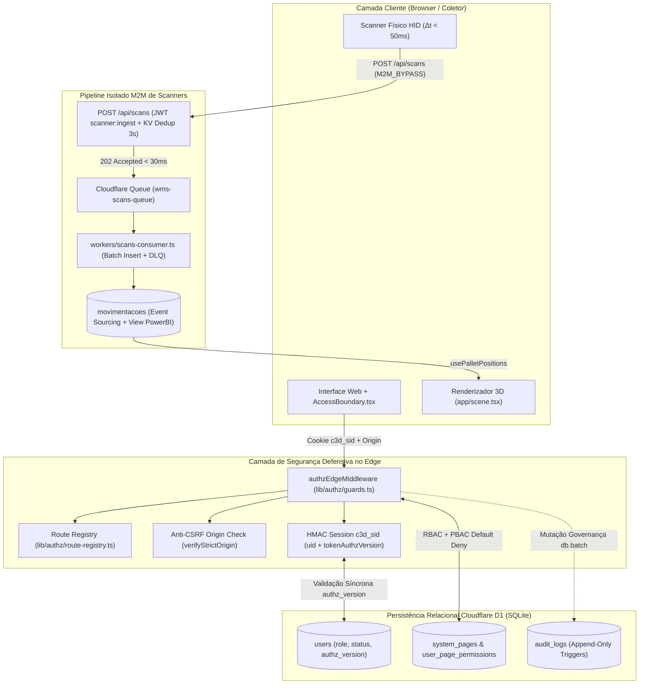

# Carga3D — Gestão de Carregamento 3D, Rastreabilidade WMS/TMS & Governança Zero-Trust no Edge

Aplicação completa para planejamento físico de paletes em caminhões, simulação de balança por eixo, emissão de romaneio oficial de expedição, visualização interativa em 3D, **ingestão de eventos de bipagem via scanner físico (HID) com Event Sourcing imutável** e **arquitetura de segurança defensiva RBAC + PBAC/ACL granular (Default Deny) sobre Cloudflare Workers e D1**.

---

## Sumário

1. [Funcionalidades Principais](#1-funcionalidades-principais)
2. [Como Executar (Automático via `.bat` ou Manual)](#2-como-executar-automático-via-bat-ou-manual)
3. [Arquitetura e Lógica do Sistema](#3-arquitetura-e-lógica-do-sistema)
   - [3.1. Motor de Cubagem 3D, Centro de Gravidade e Romaneio](#31-motor-de-cubagem-3d-centro-de-gravidade-e-romaneio)
   - [3.2. Governança de Identidades, RBAC + PBAC Granular e Auditoria D1](#32-governança-de-identidades-rbac--pbac-granular-e-auditoria-d1)
   - [3.3. Route Registry, Prevenção de IDOR/CSRF e Invalidação Síncrona (`authz_version`)](#33-route-registry-prevenção-de-idorcsrf-e-invalidação-síncrona-authz_version)
   - [3.4. Modelagem Event Sourcing Imutável (Drizzle ORM + PowerBI)](#34-modelagem-event-sourcing-imutável-drizzle-orm--powerbi)
   - [3.5. Captura HID (`< 50ms`), Sanitização e Desacoplamento 3D](#35-captura-hid--50ms-sanitização-e-desacoplamento-3d)
   - [3.6. Pipeline Edge M2M de Scanners (`202 Accepted`), Batch Consumer e DLQ](#36-pipeline-edge-m2m-de-scanners-202-accepted-batch-consumer-e-dlq)
4. [Estrutura Completa de Arquivos](#4-estrutura-completa-de-arquivos)
5. [Bootstrap de `SUPER_ADMIN` e Comandos Operacionais](#5-bootstrap-de-super_admin-e-comandos-operacionais)
6. [Suíte de Testes Automatizados e Defensivos (23 Testes)](#6-suíte-de-testes-automatizados-e-defensivos-23-testes)
7. [Problemas Comuns e Solução Rápida](#7-problemas-comuns-e-solução-rápida)

---

## 1. Funcionalidades Principais

- **Planejamento e Visualização 3D (`app/scene.tsx`):** Simulação tridimensional de encaixe de paletes no baú, rotação permitida, folgas operacionais e destaque de itens frágeis, estritamente desacoplada de I/O bruto e da camada de autorização.
- **Balança & Distribuição por Eixo (`lib/domain.ts`):** Cálculo estático em tempo real do Centro de Gravidade (CG) longitudinal e lateral, alertando sobrecargas na cabine, no eixo traseiro ou desequilíbrio transversal.
- **Romaneio de Carga & Expedição:** Ordem sequencial física de carregamento (do fundo para a porta) e descarregamento (LIFO), impressão A4 oficial e exportação CSV.
- **Autorização Híbrida RBAC + PBAC/ACL com Default Deny (`lib/authz/*` & `db/schema-authz.ts`):**
  - Matriz estrita de papéis (`SUPER_ADMIN`, `ADMIN`, `USER`) separando módulos `OPERATIONS` e `GOVERNANCE`.
  - Proteção atômica transacional (`db.batch()` + triggers SQLite/D1) impedindo a suspensão, rebaixamento ou exclusão do último `SUPER_ADMIN` ativo.
  - Sessão compacta assinada via HMAC-SHA256 (`c3d_sid`) sem ACLs no cookie e com invalidação síncrona imediata por incremento de `authz_version`.
  - Trilha de auditoria imutável (`audit_logs`) protegida por triggers no banco.
- **Captura de Scanner Físico HID (`hooks/use-barcode-scanner.ts`):** Listener global desacoplado de inputs HTML que distingue leitura mecânica a laser/imager (`Δt < 50ms`) de digitação humana.
- **Rastreabilidade Imutável por Event Sourcing (`lib/db/schema.ts` & `lib/db/projections.ts`):** Histórico append-only de movimentações de paletes sem operações de `UPDATE`, com projeção analítica via Window Functions (`ROW_NUMBER()`) pronta para o PowerBI.
- **Ingestão Edge M2M de Alta Vazão (`app/api/scans/route.ts` & `workers/scans-consumer.ts`):** Autenticação Machine-to-Machine (`scanner:ingest`), deduplicação contra dupla bipagem em janela de 3 segundos, resposta `HTTP 202 Accepted` em `< 30ms`, processamento em lote (`Batch Insert`) e *Dead Letter Queue* (DLQ).

---

## 2. Como Executar (Automático via `.bat` ou Manual)

### Opção A: Inicialização Automática com 2 Cliques (Recomendado no Windows)

Basta dar dois cliques no arquivo **`iniciar-carga3d.bat`** (disponível tanto na raiz do repositório quanto dentro da pasta `carga3d-inicial`). O script executa automaticamente:
1. Verificação do **Node.js (v22+)** no `PATH` do Windows.
2. Criação automática do arquivo `.env` a partir de `.env-example` (caso ainda não exista).
3. Instalação automática das dependências (`npm.cmd install`) caso a pasta `node_modules` não exista.
4. Inicialização e aplicação das migrações SQL locais (`0000_chubby_skrulls.sql` e `0001_authz_rbac_pbac.sql`) no Cloudflare D1 em `.wrangler/state` (`node scripts/init-local-db.mjs`).
5. Abertura automática do navegador em **http://127.0.0.1:5173/** e inicialização do servidor de desenvolvimento.

### Opção B: Execução Manual via PowerShell / Terminal

```powershell
cd carga3d-inicial
npm.cmd run db:init
npm.cmd run dev
```

Abra **http://127.0.0.1:5173/** no seu navegador.

---

## 3. Arquitetura e Lógica do Sistema



### 3.1. Motor de Cubagem 3D, Centro de Gravidade e Romaneio
Localizado em `lib/domain.ts`, o motor determinístico:
- Ordena e posiciona paletes respeitando as dimensões internas do baú (`length`, `width`, `height`), abertura de porta (`doorWidth`, `doorHeight`), capacidade máxima em kg e regras operacionais (`sameDestination`, `lightEnd`, `fragileClearance`).
- Calcula a distribuição de peso nos eixos dianteiro e traseiro e o deslocamento transversal do Centro de Gravidade (CG) para prevenir tombamento e multas por excesso por eixo.
- Gera o romaneio sequencial garantindo que os primeiros paletes carregados ao fundo do baú correspondam à última entrega da rota.

### 3.2. Governança de Identidades, RBAC + PBAC Granular e Auditoria D1
Localizada em `db/schema-authz.ts`, `drizzle/0001_authz_rbac_pbac.sql` e `lib/authz/governance-service.ts`:

| Papel | Status Obrigatório | Módulos `OPERATIONS` (`op:*`) | Módulos `GOVERNANCE` (`gov:*`) | Isolamento de Dados (`requireResourceAccess`) |
| :--- | :--- | :--- | :--- | :--- |
| **`SUPER_ADMIN`** | `ACTIVE` | `read`, `write`, `execute` (100%) | `read`, `write`, `execute` (100% — Aprovação, Papéis, ACLs e Auditoria) | Acesso global multi-tenant auditado |
| **`ADMIN`** | `ACTIVE` | `read`, `write`, `execute` (100%) | **NEGADO (`403 GOVERNANCE_FORBIDDEN_FOR_ADMIN`)** | Restrito ao próprio `tenant_id` |
| **`USER`** | `ACTIVE` | **Default Deny (`403`)** — Liberado apenas por grant explícito `(user_id, page_key, action)` em `user_page_permissions` | **NEGADO (`403 GOVERNANCE_FORBIDDEN_FOR_USER`)** — Proibida delegação via ACL | Restrito a `owner_id === user.id` e mesmo `tenant_id` |

- **Invariante Atômico do Último `SUPER_ADMIN`:** Tanto a função `enforceAdminInvariant` quanto o predicado condicional nos `UPDATE`s e os triggers nativos `trg_protect_last_super_admin_update` / `trg_protect_last_super_admin_delete` no SQLite/D1 garantem que a suspensão, rebaixamento ou exclusão do último `SUPER_ADMIN` com `status = 'ACTIVE'` falhe atomicamente (`409 LAST_SUPER_ADMIN_INVARIANT`).
- **Transacionalidade e Auditoria Imutável (`db.batch()`):** Toda aprovação de conta (`approveUserAccount`), suspensão/reativação (`updateUserStatus`), alteração de papel (`updateUserRole`) ou concessão/revogação de ACL (`grantPagePermission` / `revokePagePermission`) executa em um único `db.batch()` contendo:
  1. A mutação principal.
  2. O incremento atômico `authz_version = authz_version + 1` na conta alvo.
  3. O registro append-only em `audit_logs` com snapshots minimizados (sem hashes/segredos), justificativa obrigatória (`reason`), `actor_id`, `target_user_id` e `request_id`. Triggers `BEFORE UPDATE` e `BEFORE DELETE` em `audit_logs` abortam qualquer tentativa de adulteração histórica.

### 3.3. Route Registry, Prevenção de IDOR/CSRF e Invalidação Síncrona (`authz_version`)
Localizada em `lib/authz/route-registry.ts`, `lib/authz/guards.ts`, `lib/auth-session.ts` e `components/authz/AccessBoundary.tsx`:
- **Normalização Estrita e Matching Determinístico:** `normalizeRoutePath` e `resolveRoutePolicy` bloqueiam bytes nulos (`%00`), barras invertidas (`\`, `%5c`), barras codificadas (`%2f`), double-encoding (`%25`), barras duplas (`//`) e segmentos de *path traversal* (`.` e `..`). Segmentos estáticos são comparados de forma case-insensitive (impedindo bypass via `/GOVERNANCA/USUARIOS`), enquanto parâmetros dinâmicos (`:id`) são validados contra `/^[a-zA-Z0-9_.:@-]{1,128}$/`. Rotas fora do registro sofrem **Default Deny (`403`)**.
- **Prevenção contra IDOR e Escalada Horizontal (`requireResourceAccess`):** Liberar a rota não basta; mutações e leituras de objetos verificam `ownerId` e `tenantId` do recurso antes de autorizar a operação.
- **Proteção Anti-CSRF no Edge (`verifyStrictOrigin`):** Todas as requisições mutáveis (`POST`, `PUT`, `PATCH`, `DELETE`) em rotas de sessão e governança exigem que o header `Origin` coincida exatamente com o host da aplicação.
- **Cookies Enxutos e Invalidação Síncrona:** O cookie `c3d_sid` (`HttpOnly; Secure; SameSite=Lax`) armazena apenas `{ uid, ver, jti, iat, exp }` assinado via HMAC-SHA256 (`crypto.subtle`). É proibido armazenar ACLs no cookie (`FORBIDDEN_CLAIMS_IN_COOKIE`). Se `claims.ver !== user.authz_version` ou `user.status !== 'ACTIVE'`, `authorizePageAccess` rejeita a requisição na hora com `401`/`403` e limpa o cookie.
- **UX Defensiva (`components/authz/AccessBoundary.tsx`):** O componente `<AccessBoundary pageKey="..." action="...">` e o hook `useAuthorization` ocultam elementos visuais não autorizados no cliente sem jamais substituir a validação obrigatória no Edge.

### 3.4. Modelagem Event Sourcing Imutável (Drizzle ORM + PowerBI)
Localizada em `lib/db/schema.ts` e `lib/db/projections.ts`:
- **Tabelas Cadastrais/Estáticas:** `skus`, `locais` (com tipo de zona e capacidade) e `pallets` (sem coluna mutável de `local_id`).
- **Tabela Imutável de Ingestão (`movimentacoes`):** Append-only com `id` (ULID ordenável), `pallet_id`, `local_id`, `tipo_evento` (`ENTRADA` | `SAIDA` | `TRANSITO` | `CONFERENCIA`), `created_at` (UTC microssegundos), `operador_id`, `dispositivo_id` e `idempotency_key` (`UNIQUE`).
- **Derivação de Estado Atual (`vw_estado_atual_pallets`):** Calculada via `ROW_NUMBER() OVER (PARTITION BY m.pallet_id ORDER BY m.created_at DESC, m.id DESC) AS rn` (`rn = 1 AND tipo_evento <> 'SAIDA'`), pronta para conexão DirectQuery/Import no **PowerBI**.

### 3.5. Captura HID (`< 50ms`), Sanitização e Desacoplamento 3D
Localizada em `hooks/use-barcode-scanner.ts`, `hooks/use-pallet-positions.ts` e `lib/validation.ts`:
- **Distinção Hardware vs. Humano:** `useBarcodeScanner` calcula o delta (`Δt`) entre eventos `keydown` globais. Apenas sequências onde todos os intervalos consecutivos são `< 50ms` terminadas por `Enter`/`Tab` são aceitas; digitação manual humana (`>= 50ms`) é descartada como `HUMAN_TYPING_SPEED`.
- **Prevenção contra Barcode Injection:** `sanitizeRawBarcode` e `HidRawScanSchema` removem caracteres de controle ASCII e exigem match com `/^[A-Z0-9\-:_/|.]{4,64}$/`, bloqueando SQLi/XSS/Command Injection via código de barras.

### 3.6. Pipeline Edge M2M de Scanners (`202 Accepted`), Batch Consumer e DLQ
Localizado em `app/api/scans/route.ts`, `lib/edge-security.ts` e `workers/scans-consumer.ts`:
- **Isolamento Estrito M2M:** `POST /api/scans` opera em canal `M2M_BYPASS` no middleware humano; cookies de navegador (`c3d_sid`) nunca substituem o Service Token JWT M2M (`scopes: ['scanner:ingest']`).
- **Deduplicação em Janela de 3s e Rate Limit:** `checkAndLockIdempotencyKey` calcula `SHA-256(dispositivoId : barcode : janela_3s)` e reserva a chave em memória do Isolate + Cloudflare KV (`WMS_DEDUP_KV`), absorvendo condições de corrida de dupla bipagem simultânea e respondendo `HTTP 202 Accepted` em `< 30ms`.
- **Consumer em Lote e DLQ:** `processScansQueueBatch` agrupa mensagens da `WMS_SCANS_QUEUE` em uma única conexão ao banco por lote (`INSERT IGNORE`), aplicando *Exponential Backoff* e encaminhando falhas persistentes ou *Poison Pills* para a Dead Letter Queue (`WMS_SCANS_DLQ`).

---

## 4. Estrutura Completa de Arquivos

```text
Controle-de-Carregamento/
├── iniciar-carga3d.bat                     # Inicializador automático 1-clique (raiz)
├── README.md                               # Documentação arquitetural completa
└── carga3d-inicial/
    ├── iniciar-carga3d.bat                 # Inicializador automático 1-clique (pasta da app)
    ├── app/
    │   ├── scene.tsx                       # Renderizador 3D (desacoplado de I/O e de autorização)
    │   └── api/
    │       ├── auth/route.ts               # Autenticação local Web (100% Web APIs, sem Buffer)
    │       ├── workspace/route.ts          # Persistência de caminhões, produtos e cargas
    │       └── scans/route.ts              # Endpoint Edge M2M de scanners (< 30ms, HTTP 202)
    ├── components/
    │   └── authz/
    │       └── AccessBoundary.tsx          # Provider, hook useAuthorization e fronteira visual Default Deny
    ├── db/
    │   ├── schema.ts                       # Schema D1 unificado (workspaces + schema-authz)
    │   └── schema-authz.ts                 # Tabelas D1: users, system_pages, user_page_permissions, audit_logs
    ├── drizzle/
    │   ├── 0000_chubby_skrulls.sql         # Migração D1 inicial (workspaces)
    │   └── 0001_authz_rbac_pbac.sql        # Migração D1 AuthZ (DDL, índices, triggers de auditoria e SUPER_ADMIN)
    ├── hooks/
    │   ├── use-barcode-scanner.ts          # Captura HID global (Δt < 50ms), sanitização e SHA-256
    │   └── use-pallet-positions.ts         # Hook de estado derivado para alimentar a cena 3D
    ├── lib/
    │   ├── domain.ts                       # Motor matemático de cubagem, balança por eixo e romaneio
    │   ├── validation.ts                   # Schemas Zod centralizados (Workspace + HID Scan + Queue)
    │   ├── auth-session.ts                 # Sessão compacta HMAC (c3d_sid), PBKDF2 WebCrypto, Origin CSRF e JWT M2M
    │   ├── edge-security.ts                # Rate Limiting por coletor + Deduplicação KV (janela 3s)
    │   ├── ulid.ts                         # Gerador ULID de 26 caracteres compatível com Edge Runtime
    │   ├── authz/
    │   │   ├── route-registry.ts           # Catálogo de páginas e resolução determinística de rotas
    │   │   ├── guards.ts                   # authorizePageAccess, requireResourceAccess, enforceAdminInvariant e Middleware
    │   │   └── governance-service.ts       # Aprovação, papéis, ACLs e auditoria transacional em db.batch()
    │   └── db/
    │       ├── schema.ts                   # Modelagem Drizzle Event Sourcing (skus, locais, pallets, movimentacoes)
    │       └── projections.ts              # View e consulta analítica (ROW_NUMBER) sem UPDATE para PowerBI
    ├── scripts/
    │   ├── init-local-db.mjs               # Aplica todas as migrações D1 locais (.wrangler/state)
    │   └── bootstrap-superadmin.ts         # Seed determinístico do SUPER_ADMIN via variáveis de ambiente
    ├── workers/
    │   └── scans-consumer.ts               # Consumer em lote da Cloudflare Queue + Backoff + DLQ
    └── tests/
        ├── domain.test.ts                  # Testes unitários de cubagem, eixos e romaneio
        ├── security-auth.test.ts           # Testes defensivos de sessão, SQLi bind e segredos
        ├── scanner-event-sourcing.test.ts  # Testes de Event Sourcing, HID < 50ms, Race Condition e DLQ
        └── authz-security.test.ts          # Testes de RBAC/PBAC, authz_version, último SUPER_ADMIN, IDOR e M2M
```

---

## 5. Bootstrap de `SUPER_ADMIN` e Comandos Operacionais

Para inicializar o banco D1 local e provisionar o primeiro `SUPER_ADMIN` sem expor credenciais no código:

```powershell
cd carga3d-inicial

# 1. Aplicar migrações D1 locais (0000 + 0001)
npm.cmd run db:init

# 2. Provisionar SUPER_ADMIN inicial via variáveis de ambiente efêmeras
$env:BOOTSTRAP_SUPERADMIN_EMAIL="secops@suaempresa.com.br"
$env:BOOTSTRAP_SUPERADMIN_NAME="SecOps Principal"
$env:BOOTSTRAP_SUPERADMIN_PASSWORD="<SENHA_FORTE_MIN_12_CARACTERES>"
npm.cmd run db:bootstrap-superadmin
Remove-Item Env:\BOOTSTRAP_SUPERADMIN_PASSWORD
```

Para aplicar em produção no Cloudflare D1 remoto:

```powershell
npx wrangler d1 execute DB --remote --file drizzle/0000_chubby_skrulls.sql
npx wrangler d1 execute DB --remote --file drizzle/0001_authz_rbac_pbac.sql
node --experimental-strip-types scripts/bootstrap-superadmin.ts --remote
```

---

## 6. Suíte de Testes Automatizados e Defensivos (23 Testes)

Para executar todos os **23 testes automatizados** (incluindo os 8 cenários de autorização RBAC/PBAC sobre SQLite/D1 real com triggers, `authz_version`, invariante do último `SUPER_ADMIN`, anti-IDOR/CSRF, cubagem 3D e pipeline HID/Event Sourcing):

```powershell
cd carga3d-inicial
npm.cmd test
```

---

## 7. Problemas Comuns e Solução Rápida

- **Entrou, mas os cadastros não carregam:** execute `npm.cmd run db:init` (ou inicie pelo `iniciar-carga3d.bat`) e atualize a página.
- **PowerShell bloqueou `npm.ps1`:** utilize sempre `npm.cmd` no lugar de `npm` ou execute diretamente o arquivo `iniciar-carga3d.bat`.
- **Porta 5173 ocupada:** encerre a outra execução ou execute `npm.cmd run dev -- --port 5174`.
